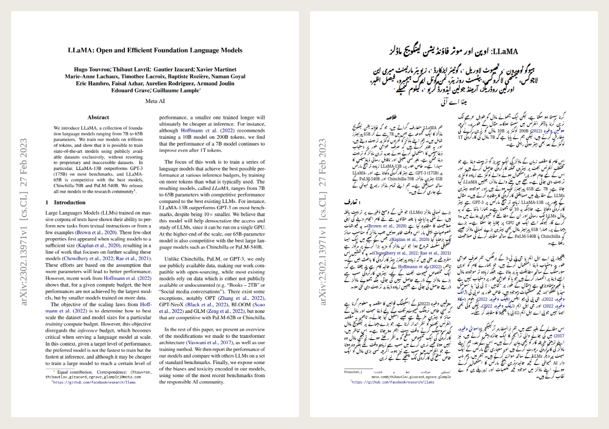
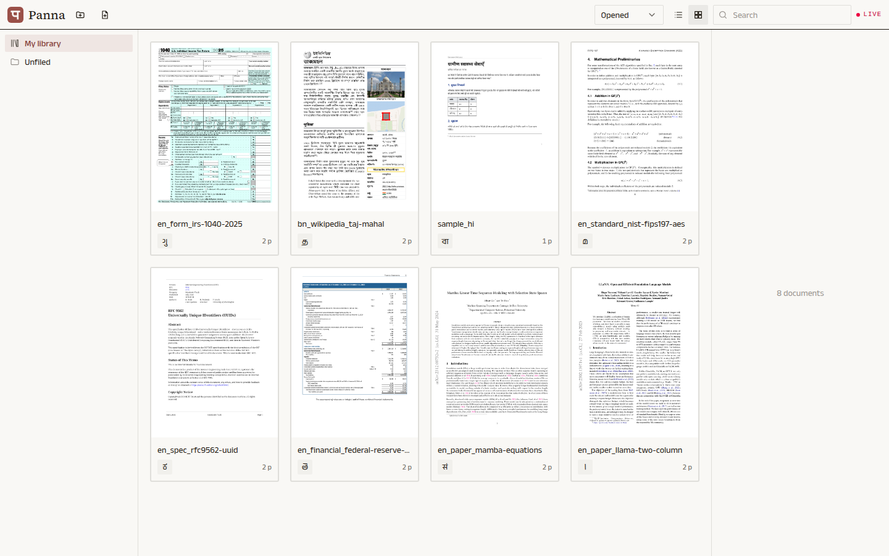
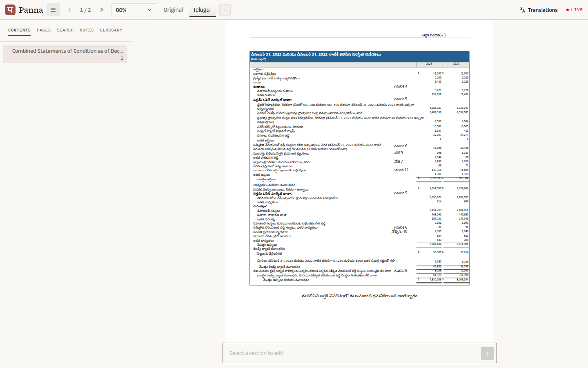
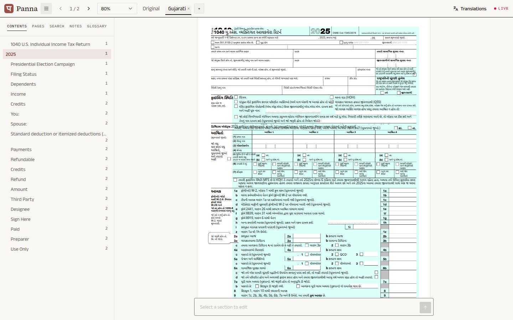
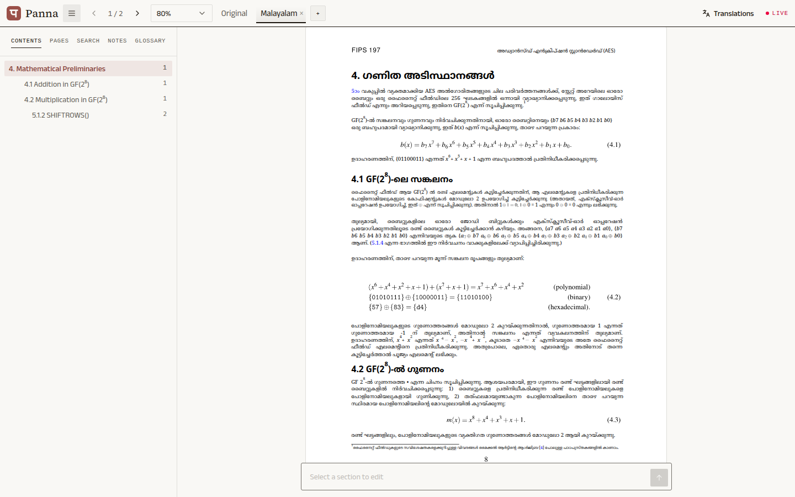
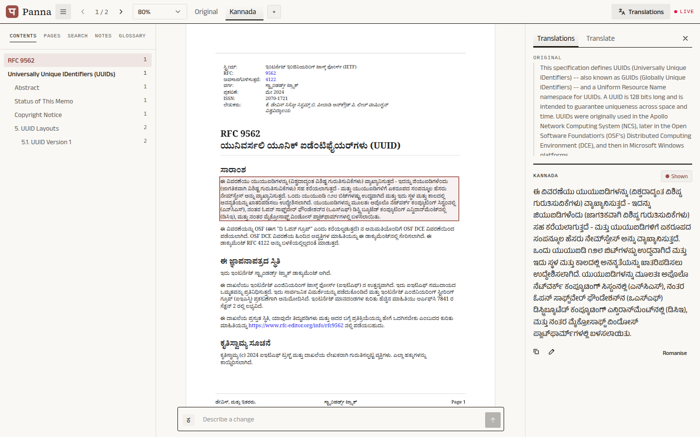

# Panna (पन्ना)

**A PDF translation studio for Indian languages.** Upload a PDF, translate it into any of India's 22 scheduled
languages, and read it the way it was printed: every heading, table, footnote, formula and figure stays where it
was, redrawn in the translation. Then revise any section by asking for the change in plain words.

*Panna* means "page" in Hindi. DA7016 course project. Translation, OCR and transliteration use
[Bodhan AI](https://console.bodhan.ai/api-docs/); prompt edits and layout review use
[OpenRouter](https://openrouter.ai) (Claude Sonnet).



<sub>The LLaMA paper, page 1, and the same page in Urdu: two columns, the title block, citations and links kept,
the text set right to left.</sub>

## Contents

[Features](#features) · [Screenshots](#screenshots) · [How it works](#how-it-works) ·
[Quick start](#quick-start) · [Using Panna](#using-panna) · [Project structure](#project-structure) ·
[Testing and quality](#testing-and-quality) · [Robustness](#robustness-and-edge-cases) ·
[Known limitations](#known-limitations) · [Documentation](#documentation) · [Credits and licence](#credits-and-licence)

## Features

**Read the page, not a text dump**
- Each language is a view of the same page: switch between the **Original** (pdf.js) and one tab per language.
- Translations are redrawn at the original's positions, sizes, weights and colours, over the page with its text
  removed. Text that runs longer shrinks to fit; anything cut off is outlined and announced.
- Tables cell by cell, multi-column papers, forms, slides, footnote markers, inline maths (drawn from the original),
  pictures that text wraps around, right-to-left scripts.
- **Hold Alt** over a language view to peek at the original underneath.

**Translate**
- 22 scheduled languages plus English, including Perso-Arabic scripts (Urdu, Kashmiri, Sindhi) and the alternative
  scripts of Kashmiri, Manipuri and Sindhi.
- A whole document, one page, or picked sections; figure text on request. A translating tab shimmers and fills with
  its progress.
- Scanned pages are read with Bodhan's OCR on request. Headings get a second, context-aware pass.
- A **glossary** pins how terms are translated, per language.

**Revise with a prompt**
- Select one or more sections and type what you want: "make it formal", "put this in Tamil", "split the authors onto
  separate lines", "make the heading bold and 14 pt". Only those sections change; every edit can be undone.
- Claude decides the change and the look; **Bodhan does every translation**, including a prompt that asks for
  another language.
- The edited sections shimmer while the model works.

**Study the text**
- Select text on any view: highlight it in four colours, comment on it, **Define** an English word (offline WordNet),
  or **Translate** the selection into your other languages, with **Romanise** for any result.
- Notes are kept per view and grouped by language in the Notes tab. Contents, page thumbnails and search in the
  sidebar.

**A library to work from**
- A Zotero-like home: folders (drag documents onto them), list or card view, sorting, search, the languages each
  document has, and an in-app confirmation for every destructive action.

**Built to be checked**
- Runs entirely against a **local mock** of Bodhan and OpenRouter by default: no keys, no credits.
- Every real API call is cached on disk (re-runs are free) and written to a usage ledger with its cost.
- 160+ tests, a 19-document test corpus, and scripts that measure rendering and translation quality.

## Screenshots

| | |
| :---: | :---: |
|  |  |
| **Library**: folders, cards, script letters for each document's languages | **Telugu**: a 138-cell financial table, rules and totals kept |
|  |  |
| **Gujarati**: the IRS 1040 form, boxes, line numbers and checkboxes in place | **Malayalam**: a standard with equations, exponents and an S-box |
|  |  |
| **Kannada**: a selected section and its translations panel | **Original**: the same page as printed, read with pdf.js |

## How it works

A PDF is read once into a JSON **document model**: pages of positioned, labelled blocks. Every stage reads and writes
that model; the studio draws pages from it.

```text
 PDF ──► 1. Ingest ──► 2. Structure review ──► 3. Translate ──► 4. Render ──► studio
          (free)          (vision model)          (Bodhan)         (HTML)        │
                                                                     ▲           │
                                                       5. Edit ◄─────┴───────────┘
                                                   (prompt → Claude → Bodhan)
```

1. **Ingest** (`backend/pipeline/ingest/`, PyMuPDF, free): text spans become lines and blocks in reading order
   (XY-cut), with tables, lists, maths runs, fonts and styles. Blocks are labelled (title, heading, paragraph,
   caption, footnote…). Each page is rasterised twice: as printed, and with its text removed.
2. **Structure review** (`structure.py`, on upload): a vision model compares each page image with the extracted
   blocks and fixes labels, splits and reading order.
3. **Translate** (`translate/`, `markup.py`): blocks are sent to Bodhan in reading order. Inline styles, footnote
   markers and formulas travel as placeholders and are restored. Headings get a context-aware second pass.
4. **Render** (`render.py`, `static/render.css`, `static/fit.js`): each translated block is drawn at its original
   box over the text-free page, in a font for its script. `fit.js` shrinks text that doesn't fit, keeps similar
   blocks at similar sizes, and flags what it has to cut.
5. **Edit** (`edit.py`): a prompt and the selected blocks go to Claude, which returns the revised text or a new look.
   When the prompt asks for another language, Claude only names it and Bodhan translates.

```text
 Browser (React studio, :5173)                 Backend (FastAPI, :8000)                     External APIs
┌──────────────────────────────┐   /api    ┌──────────────────────────────────────┐     ┌──────────────────┐
│ library/   Zotero-like home  │ ────────► │ api/       routers, one per area     │     │ Bodhan AI        │
│ studio/    pages, views,     │  (Vite    │ pipeline/  ingest · structure ·      │ ──► │ OCR, translate,  │
│            prompt box        │   proxy)  │            translate · render · edit │     │ transliterate    │
│ panels/    translations,     │ ◄──────── │ core/      model, storage, library,  │     ├──────────────────┤
│            sidebar           │  JSON +   │            jobs, languages, config   │ ──► │ OpenRouter       │
│ pdf.js     the Original view │  HTML     │ clients/   cache, ledger, pacing     │     │ edits, reviews   │
└──────────────────────────────┘           └──────────────┬───────────────────────┘     └──────────────────┘
                                                          │                  (or mock_server/ on :9000)
                                              data/{mock,live}/: documents, cache, usage ledger
```

[docs/architecture.md](docs/architecture.md) covers each stage in depth, and
[docs/reference/Structure-Flow.md](docs/reference/Structure-Flow.md) explains the fitting and structure decisions.

## Quick start

**Requirements:** [uv](https://docs.astral.sh/uv/) (it fetches Python 3.12 or newer), Node 22, Google Chrome (used for
PDF printing in the scripts and one test), and `make`.

```bash
git clone https://github.com/MO0nKe/DA7016-Project.git && cd DA7016-Project
make install        # Python and Node dependencies, plus the offline dictionary data
```

**Mock mode** (no keys, nothing spent). Run each in its own terminal:

```bash
make mock           # fake Bodhan + OpenRouter on :9000
make backend        # the API on :8000
make frontend       # the studio on http://localhost:5173
```

Open <http://localhost:5173>, drop a PDF onto the library (try one from `documents/`), and pick a language. The top
bar says **Mock**: translations are invented text in the right script, so the layout can be seen for free.

**Live mode** (real translations):

```bash
cp .env.example .env    # then add your Bodhan keys (one per model) and an OpenRouter key
make backend-live       # instead of make backend; no make mock needed
make frontend
```

The top bar says **Live**. Mock and live keep separate data (`data/mock/`, `data/live/`). Live Bodhan translation
is limited to 15 requests a minute, which the backend paces for you; a two-page paper takes a minute or two.

All settings are described in [`.env.example`](.env.example) and
[docs/getting-started.md](docs/getting-started.md), which also covers fonts, where data lives, costs and
troubleshooting. `make help` lists every command.

## Using Panna

1. **Add a PDF**: drop it on the library or use the add button. Choose a language in the dialog and press
   Translate (or *Not now* to read the original first).
2. **Read**: the studio opens with one tab per language. Switch tabs to compare; hold **Alt** to peek at the
   original; zoom with the dropdown; jump around with the sidebar's contents and page list.
3. **Translate more**: open **Translations → Translate**, choose a language, the whole document or a page, and
   whether to include text in images.
4. **Revise**: click a section (Ctrl-click for several) and describe the change in the prompt box. **Undo** reverts
   the last edit. The Translations panel shows the section in every language, with copy and romanise.
5. **Annotate**: select text for highlights, comments, Define or Translate. Notes appear in the sidebar's Notes tab.

The full walkthrough is in [docs/user-guide.md](docs/user-guide.md).

## Project structure

```text
backend/                   Python, FastAPI
  core/                    the document model (models.py), storage, library, jobs, languages, config
  pipeline/                the work, in stages:
    ingest/                  PDF → blocks: text, style, fonts, maths, tables, regions, labels, OCR, assembly
    structure.py             the vision structure review
    translate/               units, headings pass, the translation run
    markup.py                inline tags, footnote markers and formula placeholders, shared by all stages
    render.py, edit.py       drawing pages as HTML; prompt edits
    glossary.py, outline.py, evaluate.py, export.py
  api/                     the REST routers (one per area), shared services (deps.py), request bodies (schemas.py)
  clients/                 Bodhan and OpenRouter clients: request cache, usage ledger, retries, rate pacing
  services/                the offline dictionary (WordNet)
  static/                  render.css and fit.js, shared by the studio and the scripts
  tests/                   pytest
frontend/src/              React 19, TypeScript, Vite, Tailwind 4
  api/                     the backend client and types (mirroring backend/core/models.py)
  library/                 the home page
  studio/                  the reading and editing page; its state lives in studio/hooks/, one hook per concern
  panels/                  the translations panel and the sidebar
  ui/, lib/, styles/       generic components, helpers, the design tokens
mock_server/               a local stand-in for Bodhan and OpenRouter, with its tests
scripts/                   refresh_documents, check_render, evaluate, smoke_test, make_samples, make_assets…
eval/conversion/           a blind comparison of our ingest against Docling
documents/                 the test corpus: 17 two-page excerpts in 4 languages (sources and licences in SOURCES.md)
fixtures/                  sample PDFs and recorded API responses for the tests
docs/                      the documentation below
```

**Dependencies point one way:** `api` → `pipeline` → `core`; nothing imports upward. Each module opens with a
docstring saying what it owns. Conventions are in [docs/development.md](docs/development.md).

## Testing and quality

```bash
make check          # ruff lint + format check, TypeScript type-check, oxlint, the fast tests
make test           # every test, including the one that launches Chrome
```

- **Tests** cover ingest (reading order, tables, maths, labels, fonts), translation (markers, placeholders,
  headings, retries), rendering (fitting, tables, pictures, right-to-left), prompt edits, the API, the library,
  annotations, the glossary, the mock server and adversarial inputs.
- **Corpus:** `documents/` holds 17 excerpts chosen to break things: a two-column paper, an equations paper,
  financial tables, a tax form, a slide deck, a fact sheet, a standard with an S-box, a spec, an OCR'd book scan,
  an image-only scan, and Wikipedia pages in Hindi, Bengali and Tamil. Ingest and render changes are checked
  against the whole corpus.
- **Measurement:** `scripts/check_render.py` scores rendering (structure kept, overflow, size spread, fonts per
  block); `scripts/evaluate.py` scores translation for a document and language (with optional back-translation
  and an LLM judge).
- **Conversion study** (`eval/conversion/`): our ingest against [Docling](https://github.com/docling-project/docling),
  judged blind by a vision model in both orders. In an early run (2026-10-26) over the 34 corpus pages, ours won 19
  overall, Docling 13, with 2 ties; ours led on completeness, Docling on reading order and noise.
- **Live testing:** the final pass translated eight corpus documents live into eight languages (Urdu, Sanskrit,
  Telugu, Kannada, Malayalam, Bengali, Tamil, Gujarati) and checked every page, prompt edits, notes and selections.

## Robustness and edge cases

| Input | What happens |
| :--- | :--- |
| Not a PDF, an empty file | Refused: "not a PDF" |
| A damaged or truncated PDF | Refused: "this PDF is damaged and can't be read" |
| A password-protected PDF | Refused: "this PDF is password-protected" (a permissions-only PDF opens normally) |
| The same PDF uploaded twice | The existing document is returned (documents are identified by their content hash) |
| A scanned page, an image-only PDF | Marked for OCR; Bodhan reads it on request, then it translates like any page |
| A page with no text | Opens; nothing to translate |
| A language the app doesn't translate (e.g. French) | Opens, with a notice naming the language |
| A file name with a path (`../../x.pdf`) | Only the name is kept |
| Translating into the document's own language | Refused in the API; not offered in the UI |
| A selection longer than Bodhan's context | Refused with the limit; the toolbar says so |
| Rate limits, timeouts, server errors | Retried with backoff; live Bodhan calls are paced to 15 a minute |
| A model reply wrapped in prose or Markdown | Only the revision is stored |
| A broken PDF Unicode map ("fnite" for "finite") | Repaired at ingest where only the repaired word is English |
| Text too long for its box | Shrunk to fit, then cut, outlined and announced, with the full text in the panel |

These are covered by `backend/tests/test_robustness.py` and the ingest and render tests.

## Known limitations

- **Bodhan's own answers aren't checked yet.** It occasionally returns the wrong language (English for a Tamil
  request) or a chat-style answer (notes around a Sanskrit translation); both are stored as translated. They are
  documented in [docs/reference/Bodhan-Issues-2026-10-31.md](docs/reference/Bodhan-Issues-2026-10-31.md), and a
  prompt edit fixes the section.
- **Layout:** two single-line sections that overlap in the PDF can still collide (the IRS form's "Digital Assets"
  row); in tightly set scripts superscripts can touch the line above.
- **Text:** maths glyphs with no Unicode mapping are dropped from the text (the brackets of "GF(2⁸)"), though the
  formula is still drawn; chart labels stay in the original unless "Text in images" is chosen.
- **UI:** at about 1024 px wide the Translations panel opens over the page and covers the prompt box's Undo.
- **Coverage:** 8 of the 22 languages were tested live end to end; the others were checked in mock mode.

## Documentation

| | |
| :--- | :--- |
| [Getting started](docs/getting-started.md) | Install, configure, run (mock and live), where data lives, costs, troubleshooting |
| [User guide](docs/user-guide.md) | The library and the studio: views, translating, prompt edits, notes, glossary |
| [Architecture](docs/architecture.md) | The document model, the pipeline, rendering, jobs, caching, the frontend |
| [API reference](docs/api.md) | Every REST endpoint |
| [Development](docs/development.md) | Repository layout, tests, conventions, scripts, evaluation |
| [External APIs](docs/external-apis.md) | Bodhan and OpenRouter as verified live, and the mock server |
| [Style guide](docs/style-guide.md) | The UI's design system: editorial paper and ink, one terracotta accent |

## Credits and licence

- [Bodhan AI](https://console.bodhan.ai) (OCR, translation, transliteration) and [OpenRouter](https://openrouter.ai)
  (Claude Sonnet for prompt edits, the structure review and the heading pass).
- [PyMuPDF](https://pymupdf.readthedocs.io) for reading and rasterising PDFs, [pdf.js](https://mozilla.github.io/pdf.js/)
  for the Original view, [WordNet](https://wordnet.princeton.edu) via NLTK for Define,
  [Anek](https://github.com/EkType/Anek) and [Noto](https://fonts.google.com/noto) for Indic type,
  [Source Serif 4](https://github.com/adobe-fonts/source-serif) for headings.
- The test corpus is excerpted from public-domain and openly licensed documents; each source and licence is listed
  in [documents/SOURCES.md](documents/SOURCES.md).

Panna's own code is released under the [MIT licence](LICENSE). It depends on PyMuPDF, which is licensed under the
AGPL-3.0 (or a commercial licence from Artifex); distributing or hosting Panna is subject to those terms.
